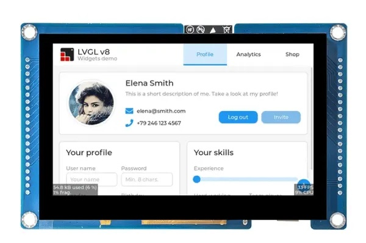

# OneDriveFrame

A standalone ESP32-S3 photo frame that downloads pictures from a Microsoft OneDrive folder and displays them on an 800 x 480 screen.

Curate your photos in OneDrive; the frame keeps local copies on an SD card and runs a slideshow without a PC or hosted backend. Existing SD photos are displayed before network setup, so viewing does not depend on signing in or completing a sync.

## Features

- Microsoft personal-account sign-in through the OAuth device-code flow.
- Wi-Fi configuration through a captive portal.
- Periodic OneDrive folder sync, with paginated listings.
- Local JPEG slideshow using an LVGL image widget.
- Aspect-ratio-preserving resizing and centering on a black background.
- Separate display and sync tasks pinned to the ESP32-S3's two cores.
- Downloads staged as `.part` files before publishing the completed image.
- SQLite photo metadata on SD and saved authentication tokens in NVS.



## Hardware and parts

| Part | Purpose |
| --- | --- |
| Viewe UEDX80480043E-WB-A display board | ESP32-S3-based 4.3-inch, 800 x 480 RGB display; current firmware target |
| PSRAM | Working memory for JPEG decoding and display buffers; enabled in the build configuration |
| SD card and SPI interface | Local photo storage and SQLite catalog |
| USB data cable and suitable power supply | Programming and powering the board |
| Wi-Fi network | OneDrive synchronization |
| Optional enclosure or stand | Turns the display board into a finished photo frame |

The display driver uses the board definition supplied by ESP32_Display_Panel. Verify your board revision and wiring before using these settings on other hardware.

### SD pin configuration

| Signal | ESP32-S3 GPIO |
| --- | --- |
| CS | 10 |
| MOSI | 11 |
| SCK | 12 |
| MISO | 13 |

The firmware also holds the resistive-touch chip-select pin, GPIO 38, high during SD initialization. SD SPI runs at 4 MHz. See [FrameConfig.h](src/FrameConfig.h) for these settings.

## How it works

```text
OneDrive / ESP32Frame
          |
   Microsoft Graph API
          |
   Sync task (core 1) ---- OAuth tokens in NVS
          |
   SD /photos + SQLite catalog
          |
   Display task (core 0)
          |
   JPEG decode -> resize -> LVGL image widget -> RGB LCD
```

### Storage-first startup

Boot waits for SD storage to mount, then selects the first readable local JPEG and renders it. Catalog reconciliation and Wi-Fi/authentication work follow afterward. Subsequent slideshow passes scan the local photo directory.

### Synchronization

The sync task lists the configured OneDrive folder, records metadata, and downloads queued image files. Completed downloads are renamed from temporary `.part` files to their final names, keeping incomplete downloads out of the slideshow.

The default sync interval is **three hours**. Local photos remain available when networking or authentication fails.

### Rendering

JPEGs are decoded with TJpg_Decoder, resized in memory, and supplied to an LVGL image widget. No display-ready image files are generated.

Images retain their aspect ratio and fit inside the screen:

- Wide landscape photos can use the full 800-pixel width.
- Portrait photos can use the full 480-pixel height.
- A 4:3 landscape photo fits at 640 x 480 rather than being cropped.

Unused screen space is black. Each successfully rendered slide remains visible for the configured interval, **eight seconds** by default.

## Getting started

### 1. Prepare storage and OneDrive

- Back up your SD card before experimenting with firmware.
- Create an `ESP32Frame` folder at the root of your OneDrive.
- Add JPEG photos you want the frame to display.
- To start with local photos, place JPEGs in `/photos` on the SD card.

> **SD safety:** The current configuration enables `kSdFormatIfEmpty`. On a failed mount, the code attempts another mount with formatting enabled. Do not assume this only affects an empty card; disable this setting before using a card containing valuable files.

### 2. Configure authentication and hardware

Review:

- [platformio.ini](platformio.ini): board selection, PSRAM, dependencies, upload port, and build flags.
- [FrameConfig.h](src/FrameConfig.h): OneDrive folder, `CLIENT_ID`, pins, timing, and display settings.

For your own Microsoft application registration, enable public-client/device-code authentication and support personal Microsoft accounts. Configure its application client ID; no client secret is required. The firmware requests delegated `Files.Read` and `offline_access` scopes.

### 3. Build and upload

Install PlatformIO, open this repository, and run:

```powershell
python -m platformio run -e esp32-s3-devkitc-1
python -m platformio run -e esp32-s3-devkitc-1 -t upload
python -m platformio device monitor -b 115200
```

The configured upload port is `COM13`; change it in [platformio.ini](platformio.ini) to match your computer. The environment name is `esp32-s3-devkitc-1`, while its PlatformIO board setting is `esp32-s3-devkitm-1`.

### 4. Connect and sign in

If no saved Wi-Fi connection is available, connect to the **OneDriveFrame Setup** access point using the portal password configured in [FrameConfig.h](src/FrameConfig.h), then open `http://192.168.4.1`.

Watch the serial console for the Microsoft verification URL and device code. Complete sign-in in your browser. The frame saves tokens and attempts to refresh them for later syncs.

## Code overview

| Module | Responsibility |
| --- | --- |
| [OneDriveFrameApp](src/OneDriveFrameApp.cpp) | Boot sequencing, FreeRTOS tasks, and synchronization state machine |
| [PhotoStorage](src/PhotoStorage.cpp) | SD initialization, photo discovery, JPEG decoding, and display |
| [GraphClient](src/GraphClient.cpp) | OAuth requests, Graph folder listing, and downloads |
| [PhotoCatalog](src/PhotoCatalog.cpp) | SQLite photo metadata and local-file bookkeeping |
| [WifiSetupManager](src/WifiSetupManager.cpp) | Wi-Fi connection and setup portal |
| [TokenStore](src/TokenStore.cpp) | Persistent authentication-token storage |

Libraries include the Arduino ESP32 framework, LVGL 8, TJpg_Decoder, ESP32_Display_Panel, WiFiManager, ArduinoJson, and Sqlite3Esp32.

## Current limitations

- The slideshow supports `.jpg` and `.jpeg`. The downloader also accepts PNG files, but PNG rendering is not implemented.
- The download queue holds 128 images per sync pass; the slideshow list holds up to 256 files.
- Photos must be readable by TJpg_Decoder; not every JPEG encoding is supported.
- This is a development firmware: HTTPS certificate verification is currently disabled, and diagnostic logs can contain sensitive authentication/download information. Do not publish raw serial logs.
- Photo sizes and SD capacity need to be managed by the user; do not rely on automatic storage-budget enforcement.

For more background and design intentions, see the [design document](docs/onedrive-frame-design.md). Some sections describe planned behavior rather than the current implementation.
